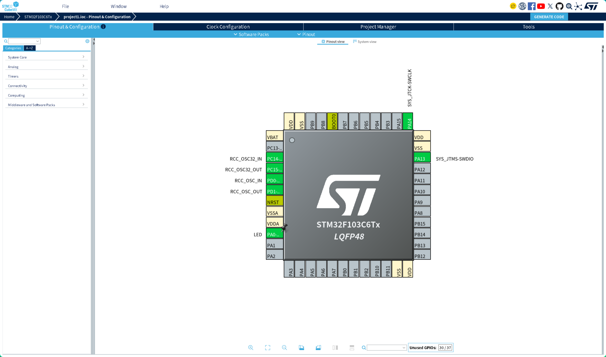
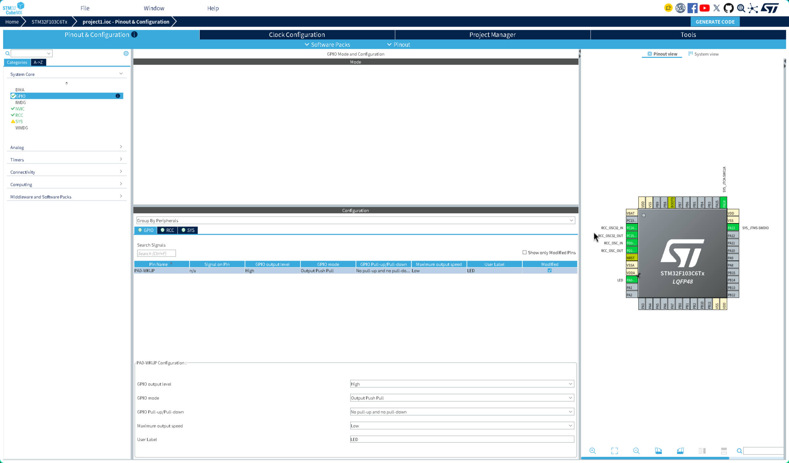
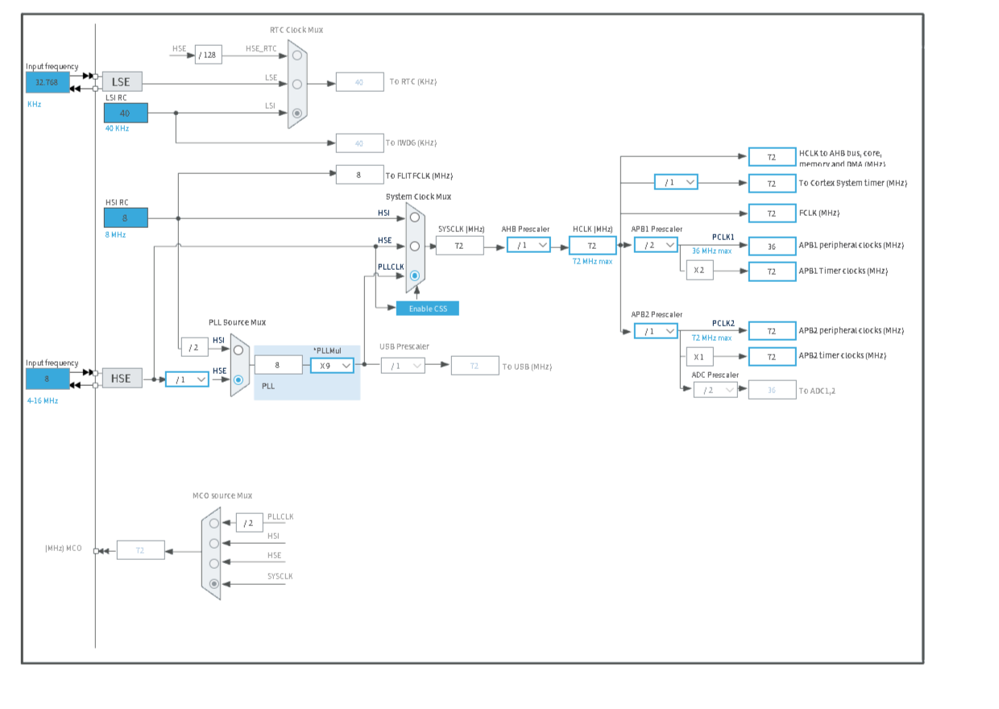

# STM32 开发技术日志

> 项目：`stm32f103-blink`（CubeMX + HAL + Makefile）
> 记录范围：环境搭建 → CubeMX 配置 → 编译烧录 → 文档与发布
> 原则：所有结论均标注依据；推测内容明确标注“未验证”。

## 1. 概述与环境

### 1.1 硬件

开发过程中使用过两块 Blue Pill 板，均由同一只 ST-Link V2 连接（序列号 `37FF71064E573436468B1243`）：

| 板卡 | 实测 `chipid` | Flash | SRAM | 说明 |
|---|---|---|---|---|
| 板 A | `0x412`（STM32F1xx_LD）| 32768 B | 10240 B | 早期使用，对应型号 **STM32F103C6T6A** |
| 板 B | `0x410`（STM32F1xx_MD）| 131072 B | 20480 B | 当前测试板，标称 “C8T6”，实际探测 128 KB |

> 板卡切换的证据见第 6.4 节。工程按**两块板中较小的容量（32 KB Flash / 10 KB RAM）**配置，因此在两块板上都能运行。

| 项 | 值 |
|---|---|
| 调试器 | ST-Link V2（V2J37S7），SWD |
| 目标电压 | 3235–3236 mV（实测）|
| 晶振 | 8 MHz（HSE）|
| LED | 外接于 PA0，`PA0 → 220Ω → LED → GND`（高电平点亮）|

### 1.2 软件

| 工具 | 版本 | 备注 |
|---|---|---|
| GCC | 16.2.0（`arm-none-eabi-gcc`）| Arch 包 `arm-none-eabi-gcc` |
| GDB | 17.2（`arm-none-eabi-gdb`）| |
| stlink | 1.9.0 | 提供 `st-info` / `st-flash` |
| OpenOCD | 0.12.0 | |
| STM32CubeMX | 6.18.1（AUR，JavaFX 版）| 固件包 FW_F1 V1.8.7 |
| Java | Temurin 21.0.10 | CubeMX 自带 JRE |

### 1.3 工程结构

```
STM32F103C6Tx/
├── project1.ioc              # CubeMX 工程
├── Makefile                  # Toolchain = Makefile
├── STM32F103xx_FLASH.ld      # Flash 32K @0x08000000, RAM 10K @0x20000000
├── startup_stm32f103x6.s     # 低密度启动文件
├── Core/{Inc,Src}            # 应用代码
└── Drivers/{CMSIS,STM32F1xx_HAL_Driver}
```

## 2. GPIO 配置

### 2.1 配置项

| 参数 | 值 | 依据 |
|---|---|---|
| 引脚 | PA0 | `.ioc`: `PA0-WKUP.Signal=GPIO_Output` |
| GPIO output level | High（初始高电平）| `.ioc`: `PA0-WKUP.PinState=GPIO_PIN_SET` |
| GPIO mode | Output Push Pull | `Core/Src/gpio.c` |
| Pull-up/Pull-down | No pull-up and no pull-down | 同上 |
| Maximum output speed | Low | 同上 |
| User Label | `LED` → 生成宏 `LED_Pin` / `LED_GPIO_Port` | `Core/Inc/main.h` |

### 2.2 生成的初始化代码（`Core/Src/gpio.c`）

```c
__HAL_RCC_GPIOA_CLK_ENABLE();

/*Configure GPIO pin Output Level */
HAL_GPIO_WritePin(LED_GPIO_Port, LED_Pin, GPIO_PIN_SET);

GPIO_InitStruct.Pin   = LED_Pin;
GPIO_InitStruct.Mode  = GPIO_MODE_OUTPUT_PP;
GPIO_InitStruct.Pull  = GPIO_NOPULL;
GPIO_InitStruct.Speed = GPIO_SPEED_FREQ_LOW;
HAL_GPIO_Init(LED_GPIO_Port, &GPIO_InitStruct);
```

说明：GPIO 时钟必须在配置前使能，否则寄存器写入无效；`HAL_GPIO_WritePin` 先设电平再初始化，可避免上电瞬间的毛刺。

### 2.3 CubeMX 界面

**Pinout 视图**（PA0 显示为绿色 `LED`，PA13/PA14 为 SWD）：



**GPIO 参数面板**（`System Core → GPIO → PA0-WKUP`）：



## 3. 时钟配置

### 3.1 时钟树



### 3.2 参数（取自 `.ioc` 与界面）

| 节点 | 值 | 依据 |
|---|---|---|
| HSE | 8 MHz | 板载晶振；`stm32f1xx_hal_conf.h: HSE_VALUE 8000000` |
| PLL 源 | HSE | `RCC.PLLSourceVirtual=RCC_PLLSOURCE_HSE` |
| PLL 倍频 | ×9 | `RCC.PLLMUL=RCC_PLL_MUL9` |
| SYSCLK | 72 MHz | `RCC.SYSCLKFreq_VALUE=72000000` |
| AHB 预分频 | /1 → HCLK 72 MHz | `RCC.AHBFreq_Value=72000000` |
| APB1 预分频 | /2 → 36 MHz | `RCC.APB1CLKDivider=RCC_HCLK_DIV2` |
| APB2 预分频 | /1 → 72 MHz | `RCC.APB2Freq_Value=72000000` |
| 定时器时钟 | APB1 定时器 72 MHz、APB2 定时器 72 MHz | `RCC.APB1TimFreq_Value` / `APB2TimFreq_Value` |
| ADC 预分频 | /2 → 36 MHz | `RCC.ADCFreqValue=36000000` |
| USB 预分频 | /1 → 72 MHz | `RCC.USBFreq_Value=72000000` |

> ⚠️ USB 当前配置为 72 MHz（预分频 /1），不满足 USB 2.0 全速所需的 48 MHz。本项目未使用 USB，因此不影响运行；若后续启用 USB，需把预分频改为 **/1.5**（72 / 1.5 = 48 MHz）。
>
> 该值来自 `.ioc` 与时钟树截图，属实际配置，非推测。

### 3.3 代码侧说明

`SystemClock_Config()` 由 CubeMX 生成，依次配置 HSE、PLL、总线分频与 Flash 等待周期；`HAL_Init()` 中初始化的 SysTick 使用 HCLK/8 作为时基，提供 1 ms 节拍，是 `HAL_Delay()` 的时间来源。

## 4. 闪烁周期计算

代码位于 `Core/Src/main.c` 的 `USER CODE BEGIN 3` 区段：

```c
while (1)
{
  HAL_GPIO_WritePin(LED_GPIO_Port, LED_Pin, GPIO_PIN_SET);   /* 亮 */
  HAL_Delay(200);
  HAL_GPIO_WritePin(LED_GPIO_Port, LED_Pin, GPIO_PIN_RESET); /* 灭 */
  HAL_Delay(800);
}
```

计算：

```
T_high  = 200 ms
T_low   = 800 ms
T       = T_high + T_low = 1000 ms
f       = 1 / T          = 1 Hz
占空比  = 200 / 1000     = 20 %
```

误差来源（理论分析）：

| 来源 | 量级 | 说明 |
|---|---|---|
| SysTick 粒度 | ±1 ms | `HAL_Delay` 按 1 ms 计数 |
| 晶振精度 | 约 ±20 ppm | 8 MHz 晶振，折算 1 s 周期误差约 0.02 ms |
| 函数调用 / GPIO 翻转 | μs 级 | 可忽略 |

> 说明：以上为计算值，未使用示波器或逻辑分析仪实测；如需精确值应以仪器测量为准。

## 5. 验证现象

### 5.1 编译

```
$ make -j$(nproc)
$ arm-none-eabi-size build/project1.elf
   text    data     bss     dec     hex   filename
   3376      12    1572    4960    1360   build/project1.elf
```

| 资源 | 占用 | 容量（按 32 KB / 10 KB 配置）| 比例 |
|---|---|---|---|
| Flash | 3388 B（text+data）| 32768 B | 10.3 % |
| RAM | 1584 B（data+bss）| 10240 B | 15.5 % |

### 5.2 烧录（板 B，`chipid 0x410`）

```
$ st-flash --reset write build/project1.bin 0x08000000
Starting Flash write for VL/F0/F3/F1_XL
Successfully loaded flash loader in sram
1/4   pages written ... 4/4 pages written
Flash written and verified! jolly good!
NRST is not connected --> using software reset via AIRCR
```

烧录、校验、软复位均成功。

### 5.3 运行现象

| 观察项 | 预期 | 实测 | 状态 |
|---|---|---|---|
| LED 亮/灭时序 | 亮 200 ms、灭 800 ms | — | ⬜ 待目测确认 |
| 周期 | 约 1 s | — | ⬜ 待目测确认 |
| 复位后自动运行 | BOOT0=0 时运行 Flash 程序 | 烧录后软复位成功 | ✅ 已验证（复位动作）|

> 目测结果需由使用者观察后补充，本文档不预设结论。

### 5.4 复现步骤

```bash
cd project1
make -j$(nproc)
st-flash --reset write build/project1.bin 0x08000000
st-info --probe            # 确认 chipid / flash / sram
```

## 6. 问题留痕

### 6.1 CubeMX 2 安装器窗口无法交互

- **现象**：运行 `stm32cubemx2-1.1.2-X64-Linux-installer` 后窗口出现，但点击无响应。
- **可能原因**：该安装器为 Tauri 应用（`ldd` 显示链接 `libwebkit2gtk-4.1`，二进制内含 `stm32-cube-installer-framework`、`tauri-version`）；本机为 Hyprland + NVIDIA，WebKitGTK 的 DMABUF 渲染在该组合下存在兼容问题。**此因果未做验证**。
- **解决**：改用 AUR 的 JavaFX 版 `stm32cubemx 6.18.1`，正常启动。
- **状态**：绕行方案有效，根因未确认。

### 6.2 CubeMX 界面字体发虚

- **现象**：JavaFX 界面文字模糊、边缘发虚。
- **证据**：`hyprctl monitors` 显示 `scale: 1.6`（非整数）；`/usr/bin/stm32cubemx` 启动脚本未传任何 JVM 参数；JavaFX 21 通过 XWayland 运行。
- **可能原因**：XWayland 窗口按 1× 渲染后被合成器放大 1.6 倍，属于位图放大。
- **解决**：
  1. Hyprland 配置 `xwayland { force_zero_scaling = true }`（`hyprctl getoption xwayland:force_zero_scaling` 返回 `true`）；
  2. 包装脚本以 `-Dglass.gtk.uiScale=1.6 -Dprism.lcdtext=false` 启动。
- **状态**：配置已生效；字体观感由使用者确认，文档不宣称“已完全解决”。

### 6.3 芯片容量与标称不符（板 A）

- **现象**：`st-info --probe` 报 `STM32F1xx_LD`、`flash 32768`、`sram 10240`、`chipid 0x412`，与“C8T6（64 KB / 20 KB）”不符。
- **证据**：`chipid.c` 输出的 `flash_size_reg 0x1ffff7e0` 读数为 `0x0020`（32 KB）。
- **原因**：板 A 实际为低密度型号（对应 C6T6A），非 C8T6。
- **解决**：CubeMX 选择 `STM32F103C6Tx`，启动文件 `startup_stm32f103x6.s`，宏 `-DSTM32F103x6`，链接脚本改为 32K/10K。
- **状态**：已验证。

### 6.4 更换开发板后容量变化（板 B）

- **现象**：同一只 ST-Link（序列号 `37FF71064E573436468B1243`，未重新插拔）在 19:37 读到 `0x412 / 32 KB / 10 KB`，20:56 连续三次读到 `0x410 / 128 KB / 20 KB`。
- **原因**：目标芯片被更换（经使用者确认换为标称 C8T6 的板子）；`0x410` 为中密度。
- **解决**：工程保持按 32 KB / 10 KB 的保守配置，因此在板 A、板 B 上均可运行；文档同时记录两块板的实测参数。
- **状态**：已验证（连续三次探测结果一致）。

### 6.5 Git 仓库体积异常

- **现象**：`git add .` 预计提交 68 MB。
- **证据**：`du -sh` 显示 `Drivers` 68 MB，其中 `CMSIS/Lib` 35 MB、`CMSIS/DSP` 14 MB、`build` 2.5 MB；`Makefile` 的包含路径只用到 `CMSIS/Device` 与 `CMSIS/Include`。
- **解决**：`.gitignore` 排除 `build/`、`compile_commands.json`、`CMSIS/{Lib,DSP,NN,RTOS,RTOS2,Core_A,docs}`；实际提交 282 个文件，`.git` 目录压缩后 5.2 MB。
- **状态**：已验证。

### 6.6 `git push` 报 `cannot run ssh`

- **现象**：`git push` 失败，提示 `cannot run ssh: 没有那个文件或目录`。
- **证据**：`command -v ssh` 为空，`pacman -Q openssh` 显示未安装；`github.com:22` 端口可达。
- **解决**：安装 `openssh`，生成 ed25519 密钥并添加到 GitHub；`ssh -T git@github.com` 返回 `Hi 0721-Artcore!`；remote 改为 SSH 后推送成功。
- **状态**：已验证。

### 6.7 截图被其他窗口遮挡

- **现象**：首次截取 GPIO 配置时，画面左半部分被终端窗口覆盖。
- **原因**：CubeMX 与终端同在 `special:min` 工作区并排布局，`grim -g` 截取区域包含两个窗口。
- **解决**：通过 Hyprland dispatch 将 CubeMX 最大化（`fullscreen mode=maximized`），确认 `fs=1` 后按工作区坐标重新截取。
- **状态**：已验证。

## 7. 附录

### 7.1 常用命令

```bash
# 构建
make -j$(nproc)
arm-none-eabi-size build/project1.elf

# 生成 clangd 数据库（供 Neovim LSP）
make clean && bear -- make -j$(nproc)

# 烧录 / 探测
st-flash --reset write build/project1.bin 0x08000000
st-info --probe

# 调试
openocd -f interface/stlink.cfg -f target/stm32f1x.cfg
arm-none-eabi-gdb build/project1.elf -ex 'target extended-remote :3333'
```

### 7.2 已知待办

| 项 | 说明 |
|---|---|
| LED 目测 | 烧录已成功，需人工确认 200 ms / 800 ms 时序 |
| USB 时钟 | 当前 72 MHz，如启用 USB 需改为 /1.5（48 MHz）|
| clangd | `compile_commands.json` 已生成（19 条），尚缺 `--query-driver=/usr/bin/arm-none-eabi-*` 配置 |

### 7.3 参考

- [STM32F103C6 数据手册](https://www.st.com/en/microcontrollers-microprocessors/stm32f103c6.html)
- [STM32CubeMX](https://www.st.com/en/development-tools/stm32cubemx.html)
- [stlink](https://github.com/stlink-org/stlink)
